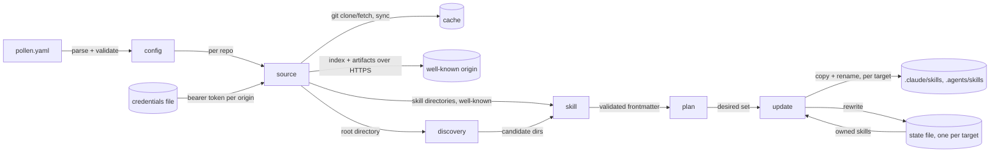

# Architecture

## Overview

`pollen` is a one-shot CLI. A run reads `pollen.yaml`, makes every source
it declares available on the local filesystem, works out which skill
directories those sources select, and then makes each target directory match
that set — installing, replacing and removing as needed. The sources are
fetched and validated once and applied to every target, so deploying to two
directories costs one fetch. Nothing runs in the background, and nothing is
left behind between runs except a cache and one state file per target.
The same engine runs behind the `pollen` binary and behind the `pollen`
Python package, which calls it in-process.

## Components

The workspace holds two crates: [pollen/](pollen/), the library and the CLI,
and [pollen-py/](pollen-py/), the Python bindings. Each component below maps
to a module under [pollen/src/](pollen/src/), except the last.

- **[config](pollen/src/config/mod.rs)** — owns `pollen.yaml` and every
  rule about it, and keeps parsing apart from running.
  [config/raw](pollen/src/config/raw.rs) holds one set of serde types per
  format version, each with its schema and its validation in its own
  vocabulary: an entry is a `repo` or a `well-known` origin, a git source
  is pinned to a revision, `local` and `well-known` are not, a `path` never
  climbs out of its source, an `exclude` compiles as a regular expression, a
  `digest` is a lowercase SHA-256. A validated file is converted, an older
  version through each newer one, into the model every command reads:
  `Config` and the `Repo` enum (`Local`, `Git`, `WellKnown`), where a key
  that does not belong to its kind of source cannot be represented. It
  resolves the target directories from the CLI overrides, the
  config, then the default pair (in the working directory, or in the home
  directory with `--global`, which also reads the user-level config),
  dropping duplicates. It knows nothing about
  git or the filesystem beyond reading its own file.
- **[source](pollen/src/source.rs)** — turns one `repos:` entry into a directory on
  disk, behind the `Materializer` trait. `local` resolves to the config
  file's own directory; a git source goes through
  [source/git](pollen/src/source/git.rs), which keeps one checkout per `(url,
  revision)` pair under the cache and shells out to `git`. It resolves the
  revision to a commit and refuses to guess when it cannot. A `well-known`
  source goes through [source/well_known](pollen/src/source/well_known.rs),
  which reads the origin's discovery index, selects skills by name, and
  downloads each artifact, checks it against the index's digest and unpacks
  it through [source/archive](pollen/src/source/archive.rs). It hands back
  the skill directories themselves, so discovery has no part in it.
- **[http](pollen/src/http.rs)** — the HTTP client of `well-known` sources. It
  follows redirects itself, so the decision to attach a token is taken again
  on every hop, and it bounds every body it reads. A connect timeout and a
  read-inactivity timeout stop a stalled server from hanging a run, with no
  total timeout so a slow, healthy download of a large artifact completes;
  its messages never carry a URL's query string.
- **[credentials](pollen/src/credentials.rs)** — reads the user-level
  credentials file and turns an origin into a bearer token: by running the
  helper command the file names, at most once per run, or by reading the
  variable it names. It knows nothing about HTTP.
- **[discovery](pollen/src/discovery.rs)** — walks a materialized source and answers
  which directories a `paths:` entry selects. A directory holding a `SKILL.md`
  is a skill and is never descended into, so a skill that bundles reference
  material does not spawn phantom children.
- **[schema](pollen/src/schema.rs)** — derives the JSON Schema for `pollen.yaml`
  from the same types [config/raw](pollen/src/config/raw.rs) deserialises, so the published
  schema cannot describe a file the parser would reject. One document covers
  every format version, choosing on `version`. It states the shape;
  the cross-field and semantic rules stay in `config`, which is why a config
  that satisfies the schema can still fail validation.
- **[skill](pollen/src/skill.rs)** — reads and validates a `SKILL.md`'s YAML
  frontmatter against the Agent Skills specification. Unknown keys are kept
  out of the model deliberately: agents extend the frontmatter with their own
  fields, and rejecting those would refuse perfectly good skills. It also
  refuses a skill whose text files hold an invisible character, which
  [hidden](pollen/src/hidden.rs) finds.
- **[deploy](pollen/src/deploy.rs)** — copies a skill tree and fingerprints it. Every
  install is staged in a sibling directory and moved in with a rename, and a
  replacement moves the previous version aside first so a failed rename can be
  undone.
- **[state](pollen/src/state.rs)** — the record of what `pollen` installed in one
  target directory, and the only thing that authorises it to replace or remove
  something. Each target carries its own, so targets never reason about each
  other.
- **[version](pollen/src/version.rs)** — which of a remote's tags are releases
  (stable `vX.Y.Z`), which is newest, and which one a revision stands for.
  `outdated` and `autoupdate` read the tags with `git ls-remote`, without
  fetching, and compare each pinned `well-known` skill with the digest its
  index publishes. With a minimum release age they also need the date of each
  release they would move to, so they fetch those tags one commit deep.
  `autoupdate` rewrites the `revision:` and `digest:` lines in place rather
  than re-serialising the YAML, so comments and layout survive.
- **[command](pollen/src/command.rs)** — the subcommands. `show` checks one source
  out without any config and lists what it holds, invalid skills included.
  `validate` has two depths: the config file alone, which touches no network
  and is what the published pre-commit hook runs, and the full check that
  fetches every source and reads every skill. `plan` is shared between them:
  it is the pure "what should be deployed" half, and `update` is the half that
  touches disk. Each subcommand is a function that returns its result
  (`update::report`, `list::installed`, `validate::check`,
  `outdated::statuses`, `autoupdate::apply`, `migrate::apply`,
  `show::inspect`) and a `run`
  that prints it. Both take the global options as
  [`cli::Options`](pollen/src/cli.rs), which a library caller builds without
  clap.
- **[pollen-py](pollen-py/)** — the `pollen._pollen` extension module, built
  with PyO3 and maturin into the `pollen-skills` distribution. Each Python
  function builds an `Options`, runs one command's data function on a fresh
  tokio runtime with the GIL released, and converts the result into the
  frozen dataclasses of
  [pollen-py/python/pollen/_types.py](pollen-py/python/pollen/_types.py). A
  failed command raises `pollen.PollenError` carrying the error chain. It
  holds no logic of its own: it reaches nothing the CLI cannot.

## Data flow

**An update.** The config is parsed and validated up front, so a typo never
half-applies. Each `repos:` entry is then materialized in order; a git source
fetches its revision, falling back from a single-revision shallow fetch to a
full one, and resolves it to a commit; a `well-known` source fetches its
index, and downloads the artifacts of the skills it selects that the cache
does not hold yet. Discovery lists the candidate directories of a git or
`local` source, `skill` validates each, and the results accumulate into a plan
keyed by skill name — two sources providing one name is an error, not a
last-one-wins.

Only then does anything get written, and the same plan is then applied to each
target in turn. For each planned skill: a directory that exists but is not in
that target's state file is refused (it is someone's own work); otherwise the
source fingerprint is compared with both the state record and the installed
tree, and a match makes the skill unchanged. Anything else is staged and
renamed into place. Finally, every state entry the config no longer selects
has its directory removed, and the state file is rewritten.

**A failure part-way through.** Skills installed before the failure stay
installed and stay recorded, in the targets already processed as well as the
one that failed — the run is not a transaction, and does not pretend to be.
What cannot happen is a partially copied skill in a target:
the rename is the only step that makes an install visible. A run killed
between the copy and the rename leaves a `.pollen-staging-*` directory,
which the next run sweeps.

## State and persistence

Two stores, both disposable.

- **The cache**, at `$POLLEN_CACHE_DIR` (`<user cache>/pollen` by default), one
  git checkout per `(url, revision)`. Keying on the revision as well as the URL is
  what lets one config pin two revisions of the same repository without the
  two checkouts fighting. A minimum release age adds one bare repository per
  remote, holding the release tags whose dates were read. Under
  `well-known/`, the last index read from each origin, which `--offline`
  works from, and each unpacked artifact, keyed by its digest, which is what
  lets an unchanged skill skip the download. Deleting the cache costs a
  refetch and nothing else.
- **The state file**, `.pollen.json` inside each target directory, mapping
  each installed skill name to its source, revision, resolved commit or
  artifact digest, and tree fingerprint, and naming the config file that owns the directory. It lives
  with what it describes rather than next to the config,
  because the config is shared and version-controlled while what is on disk is
  a property of this machine. Deleting it makes `pollen` forget it owns
  those skills: the next `update` then refuses to replace them without
  `--force`.

## Design decisions

**The `git` CLI, not a linked library.** Every authentication path a user
already has — SSH agent, `credential.helper`, `insteadOf` rewrites, corporate
proxies — works because it is the same `git` they run by hand. A linked
libgit2 would reimplement a subset of that and be wrong in exactly the cases
that are hardest to debug. The cost is a process spawn per operation and a
dependency on `git` being installed, both of which are cheap for a tool whose
users have git by definition. `gix` loses for the same reason as libgit2, and
fetching tarballs over HTTP loses because every forge shapes those URLs
differently and none of them resolves a branch to a commit.

**Plain skill directories, not a package format.** The unit `pollen`
deploys is exactly what the Agent Skills specification describes, copied
verbatim, which is why one deployment serves every agent that reads the format
rather than one vendor's plugin mechanism. Generating a plugin marketplace
instead would buy namespacing and versioning, and would leave every
non-Claude client unserved by a tool whose whole premise is a shared format.

**Two target directories by default, both full copies.** Clients scan their
own directory plus `.agents/skills/`, and no single path reaches all of them,
so the default writes `.claude/skills/` and `.agents/skills/` rather than
asking the user which agent they use. Copies rather than symlinks, because a
symlink only works where the client resolves one and the two targets need not
share an ancestor. Detecting which agents are installed and targeting those
would avoid the duplication, but a deployment that changes shape with the
contents of a home directory cannot be reasoned about or reproduced in CI.

**A state file, rather than inferring ownership.** Without a record of what it
installed, a tool either refuses to remove anything (leaving orphans forever)
or removes whatever is not declared (eating hand-written skills). The state
file is what makes pruning safe.

**A digest is the pin of a `well-known` skill.** An index has no revisions: it
lists the current artifact of each skill and its SHA-256. Pinning that digest
is content-addressed, so a run deploys exactly those bytes or fails, and
`outdated`, `autoupdate` and `validate --pinned` treat it as they treat a
commit. It guarantees integrity, not retrievability: once the publisher
replaces a skill, a pinned config fails until the pin moves, and another
machine can reproduce it only while those bytes are still served. The index
records no dates either, so `--min-release-age` holds back every changed
digest rather than guess an age. See
[ADR 0002](docs/adr/0002-fetch-skills-from-well-known-discovery-indexes.md).

**A source that follows an index skips what it cannot install.** One entry
with an unknown type, a name the specification refuses or a malformed
digest is the publisher's problem, and failing on it would break every
config following that index until each adds an `exclude`. So selection
leaves it out with a warning, the same way for every command; an entry
listed under `skills` was asked for by name, and still fails the run.

**Credentials live outside the project.** `pollen.yaml` is shared and
version-controlled, so a token or a command in it would let a cloned
repository make pollen run code or send a secret anywhere. The credentials
file is the user's, at `<user config>/pollen/credentials.yaml`
(`--credentials-file` to override), and the project config only names the
origin. A helper command keeps sign-in, token caching and refresh in a tool
built for them, the way git credential helpers and `kubectl` exec plugins do,
so pollen depends on no identity provider. Its standard input and error stay
on the terminal, for a browser or device-code sign-in.

**TLS from the platform where the build allows it.** On Linux and macOS,
rustls with the operating system's trust store, so a corporate CA works
without configuration; on Windows, SChannel, because rustls' crypto provider
compiles C that does not build for MSVC from another host. Proxies come from
`HTTPS_PROXY` and friends, not from git's configuration.

**Environment variables carry a `POLLEN_` prefix.** The usual rule is that
a process owns its environment and takes bare names, and it does not hold for
a CLI: pollen runs in a shell shared with everything else, and its knobs are
exactly the generic words — `FORCE`, `DRY_RUN`, `OFFLINE`, `CONFIG_FILE` —
that something else has already exported. An inherited `FORCE=1` would turn a
refusal to overwrite a hand-written skill into an overwrite. The bare names
are not read at all, because a fallback keeps the collision it exists to
remove. Genuine cross-tool standards would keep their own names.

**Python bindings run the engine in-process.** The Python package is the
Rust library compiled into an extension module, not a wrapper around the
binary, so Python callers get typed results and exceptions without parsing
output written for people. The reasoning and the alternatives, WebAssembly
among them, are in [ADR 0001](docs/adr/0001-ship-python-bindings-built-with-pyo3.md).
The results are dataclasses defined in Python and filled from Rust rather than
PyO3 classes, so they compare, print and type-check like any other Python
value. The wheels target the stable ABI from Python 3.11, so one wheel per
platform covers every later Python. Commands run with the GIL released and
poll for pending signals every 100 ms on the calling thread, the only one
where CPython runs signal handlers. That is what turns Ctrl-C into a
`KeyboardInterrupt` that drops the command, as `SIGINT` does for the CLI.
Logs go through the `log` facade to Python's `logging`, under loggers named
after the Rust modules (`pollen.command.update`). Levels are read from Python
on every record, so a level configured after `import pollen` takes effect.

**Fingerprints, not timestamps.** A skill is unchanged when the source tree
and the installed tree hash to the same value. Timestamps would be cheaper and
would lie after a fresh clone; the hash also catches an installed copy someone
edited by hand, which is a real thing people do and then forget.

**Validation before deployment.** A skill whose frontmatter breaks the
specification stops the whole run rather than being installed and ignored by
the agent later. A skill that is silently not loaded is a worse outcome than
an error naming the file.

**Invisible characters refuse a skill.** An agent reads every code point of
a skill; a reviewer reading it on a forge or in an editor sees none of the
zero-width and bidirectional controls, tag characters or stray variation
selectors, so they carry instructions nobody approved. Every UTF-8 file of
the skill is checked, not only `SKILL.md`, since an agent reads its
references and scripts too. Stripping them would deploy bytes the publisher
never shipped, and break the digest a `well-known` skill is pinned to; a
warning would deploy the injection anyway. `--allow-hidden-characters` on
`update` and `validate` is the way past a false positive from a source the
user trusts: one explicit flag, like `--force`, and every file it lets
through still logs a warning. `exclude` stays the narrower choice when one
skill is at fault. The characters text needs are
told apart by position: a joiner between two non-ASCII characters (emoji
sequences, Persian, Indic scripts), a presentation selector after a visible
character (`⚠️`), a byte order mark opening a file.

**A versioned config, migrated in place.** A file declares its format
`version`, 1 when it sets none, and pollen reads every version up to the
newest it knows, so an upgrade never breaks a config and a rename does not
need an alias kept forever. The version moves only on a renamed or removed
key or a change of meaning, never for a new optional key. An old version is
deprecated, with a warning pointing to `pollen migrate`, only in a later
release than its successor's, and dropped later still. `migrate` edits the
file line by line like `autoupdate`, and writes it only if it loads to the
same sources and targets. See
[ADR 0003](docs/adr/0003-version-the-config-format.md).

**No lockfile.** A lockfile exists to freeze what a resolver chose: version
ranges and transitive dependencies. pollen has neither — a `revision` names one
thing, and a skill depends on nothing — so the commit pinned in `pollen.yaml`
already is the lock. The convention is the commit of a release with the tag in
a comment (`revision: <sha>  # v1.2.3`): `autoupdate --freeze` writes it,
`validate --pinned` enforces it, and Renovate can bump it like any other pinned
digest. A second file would only repeat the config, and could disagree with it.

## Invariants and constraints

- The library never writes to stdout. Only the subcommands' `run` functions
  print, so the Python bindings and any other caller get data, never text.

- Every target directory holds a full, independent copy of the deployed set.
  No target is derived from another, and none is a link into another.
- A skill's frontmatter `name` equals its directory name, and that name is
  what it deploys under. The specification requires the first; `pollen`
  enforces it rather than renaming around it.
- `pollen` only ever replaces or removes a directory recorded in the state
  file. `--force` is the single, explicit way to take over one that is not.
- A target directory has one owning config. An update prunes whatever its
  config does not declare, so a second config would delete the first one's
  skills; `update` refuses a target whose recorded config still exists, and
  `--force` hands the directory over. A recorded config that is gone (the
  project moved) is not an owner any more and is replaced silently.
- A `paths:` entry never resolves outside its source root, before or after
  symlink resolution. Each selected skill directory has the same containment
  check, including child directory symlinks. Excluded candidates are not selected.
- Managed state keys follow the same name rules as authored skills. Unsafe
  keys refuse the target before installing, pruning or sweeping staging material.
- A deployed skill's UTF-8 files hold no invisible character beyond the
  joiners, presentation selectors and opening byte order mark text needs.
  `--allow-hidden-characters` is the single, explicit way past it.
- An install becomes visible in one rename. There is no window in which the
  target holds a partially written skill.
- A `well-known` artifact is used only once its SHA-256 matches the index,
  and a pinned skill only when the index publishes its pinned digest.
- An archive unpacks inside its skill directory or not at all: an absolute
  path, a `..` component, a link leaving the directory, an entry that is not
  a file, directory or link, or more than 256 MiB unpacked refuses it.
- A token is sent to the exact origin, scheme, host and port, that the
  credentials file names, and to no other, across redirects included.
  pollen never writes it to disk or to a log.
- A revision resolves to a commit or the run fails. `FETCH_HEAD` is only
  trusted after a fetch of that exact revision, because after a full fetch it
  names the remote's default branch and would turn a mistyped tag into a
  silent deployment of `main`.

## Limitations

- Deployment is not transactional, across skills or across targets. A failure
  after the third of five skills, in the second of two targets, leaves the
  first target complete and the second partly done.
- Deploying to several targets duplicates every skill on disk. Skills are
  small, but a client that scans both `.claude/skills/` and `.agents/skills/`
  sees each skill twice and shadows one, logging a warning.
- Two sources providing the same skill name is an error with no resolution
  mechanism — no priority order, no namespacing. Rename one, or exclude it.
- Skills are copied, not symlinked, so editing a deployed skill does not edit
  its source, and the next `update` overwrites the edit.
- A source is fetched over the network on every `update` unless `--offline`
  is passed; for a `well-known` source that means its index, while an
  artifact already in the cache is not downloaded again.
- A release's age is the date on its tag, which whoever makes the tag sets.
  A backdated tag passes `--min-release-age`.
- Only regular files and directories are copied; a symlink inside a skill is
  skipped with a warning, and so is a link inside a `well-known` archive.
- Only UTF-8 files are checked for invisible characters: a file in another
  encoding is treated as binary. Tag characters are refused even in the
  subdivision flags that use them (England's, Scotland's, Wales'), and
  lookalike letters such as a Cyrillic `а` for a Latin `a` are visible, so not
  refused.
- A `well-known` archive keeps file modes only when it records them; a
  publisher that repacks a skill without them deploys its scripts without
  the executable bit.
- pollen reads the v0.2.0 discovery index only, and refuses another
  `$schema`, an index without one (v0.1.0) included.
- A credential helper runs once per run, and a refused token fails the run:
  pollen neither retries nor refreshes.
- The Python API is synchronous: a call blocks its thread until the command
  finishes. There is no `asyncio` variant.
- The Python package depends on `git` on `PATH` like the CLI, and installing
  it on a platform with no published wheel builds the sdist, which needs a
  Rust toolchain.
