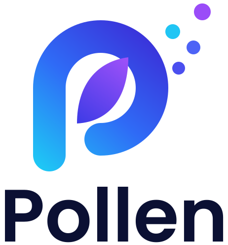

# pollen

<p align="center">
  
</p>

<p align="center">
  <a href="https://github.com/groupbees/pollen/releases/latest"></a>
  <a href="https://github.com/groupbees/pollen/actions/workflows/quality.yaml"></a>
  <a href="https://groupbees.github.io/pollen/"></a>
  <a href="LICENSE"></a>
  <a href="https://agentskills.io"></a>
  <a href="https://github.com/groupbees/pollen/stargazers"></a>
</p>

Deploy [Agent Skills](https://agentskills.io) from git repositories and local
directories, declaratively, from a single `pollen.yaml`.

## Description

`pollen` is a small CLI that reads a `pollen.yaml` describing where your
skills come from — git repositories pinned to a revision, or directories next
to the config file — and makes your skills directories match it: it installs
what is declared, refreshes what moved, and removes what you dropped. The file
is shaped after `pre-commit`'s: a list of repos, each with a revision and the
paths to pull from.

Out of the box it deploys to **both** `.claude/skills/`, which Claude Code
reads, and `.agents/skills/`, the cross-client convention every other Agent
Skills client scans — so one `pollen update` serves Claude Code, Cursor,
Codex, Antigravity CLI, Copilot, OpenCode and the rest without configuring
anything. A skill folder that also carries a `.claude-plugin/plugin.json` is
copied whole, so plugin-shaped skills keep working too.

What it is not: a registry, a package manager with dependency resolution, or a
skill authoring tool. It moves directories that already exist and validates
them against the specification.

See [ARCHITECTURE.md](ARCHITECTURE.md) for the design and the reasoning behind
it.

## Getting started

The full documentation lives at <https://groupbees.github.io/pollen/>, and
<https://groupbees.github.io/pollen/llms.txt> is its entry point for language
models.

### Prerequisites

- `git`, on `PATH`.

### Installation

With [Homebrew](https://brew.sh), on macOS and Linux:

```sh
brew install groupbees/tap/pollen
```

Otherwise, download the archive for your platform from the
[releases](https://github.com/groupbees/pollen/releases) and put `pollen` on
your `PATH`, or build it from source with Rust ≥ 1.97.1:

```sh
cargo install --git https://github.com/groupbees/pollen
```

See [Installation](https://groupbees.github.io/pollen/guides/installation/)
for the platforms and the checksums.

### Configuration

A `pollen.yaml` in the working directory lists where the skills come from:

```yaml
repos:
  - repo: https://github.com/toto/tata
    revision: 1.2.3
    paths:
      - path: mydir/
  - repo: local
    paths:
      - path: skills
```

To see what a source provides before adding it — each skill's path and
description, and the commit to pin:

```sh
pollen show https://github.com/groupbees/skills-opensource
```

Every key is in the
[configuration reference](https://groupbees.github.io/pollen/reference/configuration/),
and every option's
[environment variable](https://groupbees.github.io/pollen/reference/environment-variables/)
too.

### Usage

Deploy everything the config declares:

```sh
pollen update
```

The other commands are in
[Usage](https://groupbees.github.io/pollen/guides/usage/), and the pre-commit
hook that validates a `pollen.yaml` in
[Pre-commit hook](https://groupbees.github.io/pollen/guides/pre-commit-hook/).

### Pinning, and why there is no lockfile

Pin each source to the commit of a release and keep the tag in a comment:

```yaml
revision: 4e1e8e25a2f32d8311cd52c5d9a703bad990e525  # v0.2.0
```

A commit cannot move, and pollen resolves no version ranges and no transitive
dependencies, so the pinned `pollen.yaml` is the lock — no separate lockfile.
`pollen autoupdate --freeze` bumps the pins, `pollen outdated` shows newer
releases, and `pollen validate --pinned` enforces the convention.

### Teach your agents pollen

pollen ships an Agent Skill, [`skills/pollen`](skills/pollen/SKILL.md), so the
agents in your projects know how to edit a `pollen.yaml`, pin a source and fix
pollen's errors. Install it with pollen itself:

```yaml
  - repo: https://github.com/groupbees/pollen
    revision: <sha>  # vX.Y.Z
    paths:
      - path: skills
```

## Contributing

See [CONTRIBUTING.md](CONTRIBUTING.md).

## License

Apache-2.0 — see [LICENSE](LICENSE).
