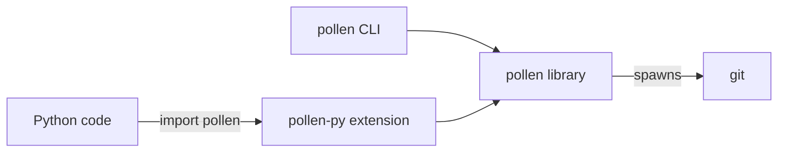

# 0001. Ship Python bindings built with PyO3

- **Status**: accepted
- **Date**: 2026-10-22

## Context

pollen is a Rust CLI. Python code wants to drive it: tooling that sets up
agent environments, CI scripts, notebooks. With the CLI alone, that code
shells out to a binary it has to install separately and then parses text
written for humans. The engine shells out to `git`, talks to remotes over
HTTPS and SSH, and writes to the filesystem. The CLI ships as native binaries
for Linux, macOS and Windows on x86_64 and arm64.

## Decision

We ship a Python distribution, `pollen-skills`, that imports as `pollen` and
runs the engine in-process. A second workspace member, `pollen-py`, binds the
`pollen` library crate with PyO3 into an extension module. maturin builds it
into one abi3 wheel per platform, for Python 3.11 and later. Each command is a
function that returns frozen dataclasses instead of printing, and raises
`pollen.PollenError` when the command fails. The release workflow publishes
the wheels and an sdist to PyPI from the same tag as the binaries.

## Consequences

- Python callers get typed results and exceptions, with no binary to install
  and no output format to parse. Logs reach Python's `logging` under the
  `pollen` logger, and Ctrl-C raises `KeyboardInterrupt`.
- The library crate becomes an API with two consumers. Each command is split
  into a function that returns data and a `run` that prints it, and the
  bindings follow every change to those functions.
- Each release builds and publishes eight more wheels and an sdist. PyPI
  trusted publishing must be configured for the `pypi` environment.
- The Python API is synchronous: a call blocks its thread until the command
  finishes, as the CLI does.
- `git` must still be on `PATH`. The bindings change how pollen is called,
  not what it depends on.
- On a platform with no wheel, installing from the sdist needs a Rust
  toolchain.

## Alternatives considered

- **WebAssembly (WASI) module run from Python**: WASI cannot spawn processes,
  so `git` would have to be replaced by an embedded implementation. Sockets,
  TLS and SSH would then be missing or partial, and tokio's multi-threaded
  runtime, process and signal support do not build for `wasm32-wasip*`. The
  result would be slower than a native wheel and unable to fetch over SSH.
- **A wheel that embeds the CLI binary** (maturin `bindings = "bin"`): no
  Rust changes at all, but Python callers still spawn a process and parse
  text. It packages the CLI and gives Python no API.
- **A pure-Python wrapper around the CLI's JSON output**: only `show` has a
  JSON format, and it would still need the binary installed and kept at a
  matching version.
