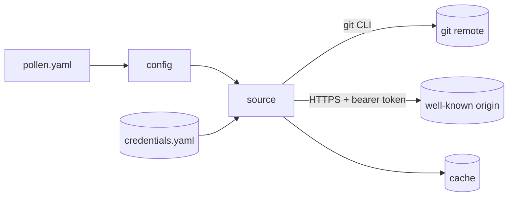

# 0002. Fetch skills from well-known discovery indexes over HTTP

- **Status**: accepted
- **Date**: 2026-11-14

## Context

pollen deploys skills from git repositories and from the config file's own
directory. Gateways and registries also publish skills over HTTP: LiteLLM
serves the skills stored on its proxy, documentation sites serve their own.
The [Agent Skills Discovery via Well-Known URIs](https://github.com/cloudflare/agent-skills-discovery-rfc)
draft (v0.2.0) gives them a common shape: an index at
`/.well-known/agent-skills/index.json` listing each skill with the URL of one
artifact, a `SKILL.md` or a `.tar.gz`/`.zip` archive, and the SHA-256 of that
artifact. An index only advertises the current artifact of each skill, and
the specification defines no authentication, while gateways usually sit
behind one.

## Decision

We add a third kind of source, `well-known: <origin>`, which reads that index
over HTTP from the `pollen` process itself, without `git`. A source takes
every skill of the index, minus an optional `exclude` pattern, or a `skills`
list of names, each optionally pinned with the `digest` of its artifact. Every
download is checked against the index's digest before it is used, archives
are unpacked under containment and size limits, and the result is cached by
digest, so an offline run works from the cache.

Tokens come from a user-level credentials file,
`~/.config/pollen/credentials.yaml`, never from `pollen.yaml`. Each entry
names an origin and either a command printing a bearer token or an
environment variable holding one. The token goes to that exact origin only,
redirects included.

## Consequences

- One source type serves every publisher of the specification, gateways and
  static sites alike, with no client code per vendor.
- A digest pins content, not a location. When the publisher replaces a
  skill, a pinned config fails rather than deploy something else, and it can
  be reproduced elsewhere only while the publisher still serves those bytes.
  Pinning guarantees integrity, not retrievability.
- pollen now speaks HTTP and TLS itself, so the proxies, CAs and credential
  helpers set up for `git` do not apply to these sources. `HTTPS_PROXY` and
  the system trust store do.
- A project config cannot make pollen run a command or send a token: the
  credentials file is the user's, and the config only names the origin.
  Interactive sign-in stays in a dedicated helper, which also caches and
  refreshes its own tokens; pollen asks it once per run and never stores the
  token.
- Archives repacked without file modes, as some publishers do, deploy their
  scripts without the executable bit. Links inside an archive are left out,
  as pollen deploys regular files only.
- The specification is a draft. pollen reads the v0.2.0 index only and
  refuses any other `$schema`, so a revision of the draft needs a change here.

## Alternatives considered

- **A client for each gateway's own API** (LiteLLM's `/v1/skills`): one
  integration per vendor, and none of them carries a digest to pin.
- **Credentials in `pollen.yaml`**: a cloned repository could then make pollen
  run a command or send a token wherever it likes.
- **Following the publisher's current artifact without pins**: no way to
  review an update before it deploys, which every other source offers.
