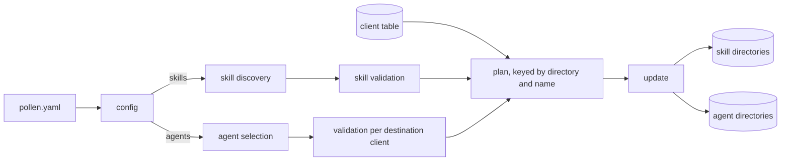

# 0004. Deploy agent definitions verbatim, per client

- **Status**: accepted
- **Date**: 2026-11-22

## Context

pollen deploys Agent Skills: one directory format, one specification, so one
copy serves every client. Subagent definitions — a Markdown file whose
frontmatter configures the agent and whose body is its system prompt — are
copied between projects by hand, with no pinning, no pruning and no review,
although they are the most privileged text an agent reads: the frontmatter
grants tools, and a Claude Code agent can also carry `permissionMode`, `hooks`
and `mcpServers`.

No specification covers them, and the clients disagree on everything that
makes an agent worth writing:

| | Claude Code | OpenCode |
| --- | --- | --- |
| Directory, project / user | `.claude/agents/` / `~/.claude/agents/` | `.opencode/agents/` / `$XDG_CONFIG_HOME/opencode/agents/` |
| Identity | the `name` field | the path under `agents/` |
| Tools | `tools`, an allowlist | `permissions` rules |
| Model | an alias (`opus`) | `provider/model#variant` |

OpenCode reads skills from `.agents/skills/`, the cross-client directory
other clients scan too. The version 2 `clients` key maps a client to one
skill directory, with `claude` for Claude Code and `agent-skills` standing
for that cross-client directory rather than for a client, and is mutually
exclusive with `targets`. Claude Code plugins already distribute agents, for
Claude Code only, through a marketplace.

## Decision

**Scope.** pollen deploys an artifact when it is a single file of prompt text,
holding no state, that a client reads from a directory it knows. Agents
qualify; a client whose agents live inside a shared config file
(`opencode.json`) is refused rather than adapted, since pollen owns whole
entries recorded in its state file, never parts of a file. `discovery`
origins stay skills-only: the v0.2.0 index has no agent type.

**Verbatim.** An agent file is copied byte for byte into the agent directory
of each client its entry deploys for. pollen never translates between
formats: a file deployed for two clients must suit both, and is validated
against each of them.

**Clients are data.** Each client is one row of a table: an optional skill
directory, an optional agent directory, its user-level root, its agent file
extension, how it names an agent, and the frontmatter fields it requires.
Adding a client is adding a row; there is no adapter trait and no
user-defined client. A row is a product, named as the product names itself;
never a directory convention.

| Client | Skills | Agents | User-level root | Identity | Required |
| --- | --- | --- | --- | --- | --- |
| `claude-code` | `.claude/skills` | `.claude/agents` | `~` | `name`, equal to the file stem | `name`, `description` |
| `opencode` | `.agents/skills` | `.opencode/agents` | `$XDG_CONFIG_HOME/opencode` for agents | the file stem, flat | `description` |

Another client reading `.agents/skills` gets a row of its own, sharing that
skill directory, once its behaviour is checked; the deduplication of target
directories keeps one copy. A client the table does not list is served
through `targets`.

**Declaring agents.** A git or `local` entry of `repos` takes an `agents:`
list beside `skills:`. Following
[ADR 0003](0003-version-the-config-format.md), it is a new optional key of
version 2, which does not move the version; a version 1 file using it is
refused with a hint to migrate, as `clients` is. Each item names a `path`,
an optional `exclude` and an optional destination. The files directly under
`path` with the agent extension, `.md` for every client in the table, are
agents; a file whose frontmatter is invalid fails the run, as a skill does.

**Destinations, per entry.** Every entry of `repos[].skills`,
`repos[].agents` and `discovery` says where it lands, the same way for skills
and agents: `clients`, one or a list, or `targets`, directories; the two are
mutually exclusive. An entry naming neither takes the top-level `clients`.
For a skill, a client stands for its skill directory; for an agent, for its
agent directory, and the file is validated against that client's identity
rule and required fields. An agent sent to `targets` has no client, so it
passes only the checks every client shares: a frontmatter, a file stem
following the name rules, no invisible character. Version 2 has no top-level
`targets`: `pollen config migrate` copies a version 1 `targets` into each
entry. The plan is keyed by destination directory and name, so a skill and an
agent, or one name in two directories, do not collide; two entries sending
one name to the same directory is an error.

**Where things land.**

- The top-level `clients` defaults to `all`, every client pollen knows, and
  `all` grows as pollen learns clients. With `claude-code` and `opencode`, it
  writes the same skill directories as the default before agents. A
  directory is created only when something is planned for it.
- A run with `--target` deploys skills only, into those directories in place
  of every entry's destination, and visits no agent directory. A run with
  `--client` deploys only what the config sends to those clients, into
  their directories: an entry whose clients, its own or the top-level ones,
  do not include them, or that names `targets`, deploys nothing in that
  run.
- With neither flag, the run also visits every known client directory in its
  scope whose state file names this config, and prunes what the config no
  longer plans there. Dropping a client, or moving an entry from `clients` to
  `targets`, therefore removes what pollen deployed there.

**State.** The state file records its kind, `skills` or `agents`, and pollen
refuses to deploy one kind into a directory owned for the other. An agent
entry is a file; its staging copy is a dot-prefixed name without the agent
extension, so no client loads it. The state version moves to 2; a version 1
file reads as `skills`.

**Review.** The invisible-character check
([#82](https://github.com/groupbees/pollen/pull/82)) applies to agent files.
`show` and the `update` summary display, for each agent, its tools, model,
permission mode and whether it declares hooks or MCP servers.

## Consequences

- One config deploys agents for several clients with the pinning, ownership,
  pruning and checks skills already have, project-locally, with no
  marketplace.
- One agent file can serve two clients when it suits both. When their
  formats disagree on what the agent needs — tools, model — the author keeps
  one file per client, each under an entry naming its client; pollen never
  keeps them in step.
- With the default `all`, an agents entry naming no client deploys its files
  to every client in the table, so a file written for one client reaches the
  others as written, once it passes their validation.
- Upgrading pollen can change what `all` deploys. A new client sharing an
  existing skill directory adds nothing, and one with an agent directory adds
  the agents of every entry naming no client; a client with a skill directory of
  its own would add a copy of every skill on upgrade, and its release notes
  must say so.
- A run can modify a directory its config no longer names, though only one
  whose state file names that config. A directory no entry's `targets` names
  any more keeps what pollen deployed there, as pollen cannot know it.
- A config sending everything to one directory of its own repeats `targets`
  on each entry.
- `--target` cannot exercise agents; testing them goes through `--client`.
- `--client` cannot deploy for a client the config does not send anything
  to: it narrows a run, it does not redirect it.
- A tool pollen does not know cannot receive agents until a release adds its
  row.
- Nested OpenCode agents (`team/reviewer.md`) are not supported, since a state
  key never holds a `/`.
- pollen refuses state files from a later version, so a version 2 file stops
  an older pollen until it is upgraded.
- No value selects "every client reading `.agents/skills`": a user of a
  client absent from the table writes `targets: [.agents/skills]` on an
  entry, and widening that set takes a release per client.
- The `clients` surface — the key, `--client`, `POLLEN_CLIENTS`, `clients=`
  in Python — stays, with `claude-code` and `opencode` as its values instead
  of `claude` and `agent-skills`; the one-directory `Client` becomes the
  table, and the top-level `targets` of version 2 moves onto each entry.
  Version 2 and `clients` are unreleased, so these changes land before the
  first release that carries them, and no release ships the old shape.

## Alternatives considered

- **Claude Code plugins**: they serve one client, through a marketplace, and
  leave OpenCode agents and project-local, pinned deployment unaddressed.
- **Translating to a common format**: the shared ground, frontmatter plus a
  prompt, drops tools and model, so pollen would deploy something other than
  what the author wrote.
- **A client adapter trait**: a client's behaviour is data with no I/O of its
  own to isolate in tests, so a trait adds dispatch for nothing.
- **A row for the `.agents/skills` convention (`agent-skills`)**: it names a
  directory, not a tool, has no agent directory, and choosing it says nothing
  about which client is in use, which is what the agent rows depend on.
- **`open-code`**: the project writes itself `opencode`, in its command, its
  config file and its directory.
- **User-defined clients in `pollen.yaml`**: they bypass per-client validation
  and the identity rule that stops one agent shadowing another.
- **A top-level `targets` beside the top-level `clients`**, mutually
  exclusive: a config with a skill directory of its own could never deploy
  agents. Combined, `targets` replacing the skill directories only: two keys
  each decide half of every destination, `clients` is silently inert for
  skills, and moving skills to `targets` removes them from the clients'
  directories with nothing in the entry saying so.
- **A required `client` on each agents entry**: it keeps one file per client
  by construction, but declares an agent's destination differently from a
  skill's, and needs one entry per client for a file that suits several.
- **`--client` sending every entry to those clients**: two entries holding
  one name for two different clients would collide in the one directory
  they are redirected to, and a run would deploy a file to a client its
  config never named.
- **`--target` deploying agents too**: a one-off run into a scratch directory
  would rewrite the user's real agent directories.
- **Leaving a dropped client's directories in place**: consistent with a
  dropped target, but it leaves agents — privileged text — deployed after the
  config stopped declaring them.
- **A fixed default list**: predictable across upgrades, but `all` would then
  mean something other than the default.
