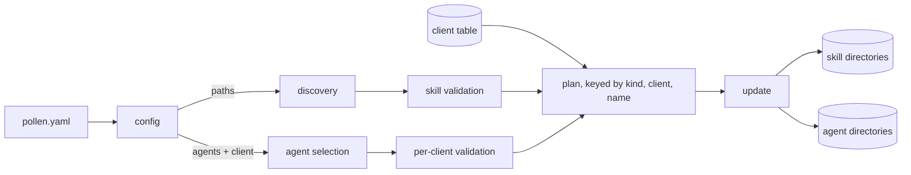

# 0004. Deploy agent definitions verbatim, per client

- **Status**: proposed
- **Date**: 2026-11-22

## Context

pollen deploys Agent Skills: one directory format, one specification, so one
copy serves every client. Subagent definitions — a Markdown file whose
frontmatter configures the agent and whose body is its system prompt — are
copied between projects by hand, with no pinning, no pruning and no review,
although they are the most privileged text an agent reads: the frontmatter
grants tools, and a Claude Code agent can also carry `permissionMode`, `hooks`
and `mcpServers`.

No specification covers them, and the clients disagree on everything that
makes an agent worth writing:

| | Claude Code | OpenCode |
| --- | --- | --- |
| Directory, project / user | `.claude/agents/` / `~/.claude/agents/` | `.opencode/agents/` / `$XDG_CONFIG_HOME/opencode/agents/` |
| Identity | the `name` field | the path under `agents/` |
| Tools | `tools`, an allowlist | `permissions` rules |
| Model | an alias (`opus`) | `provider/model#variant` |

OpenCode reads skills from `.agents/skills/`, the cross-client directory
other clients scan too. `clients`
([#83](https://github.com/groupbees/pollen/pull/83)) maps a client to one
skill directory, with `claude` for Claude Code and `agent-skills` standing
for that cross-client directory rather than for a client, and is mutually
exclusive with `targets`. Claude Code plugins already distribute agents, for
Claude Code only, through a marketplace.

## Decision

**Scope.** pollen deploys an artifact when it is a single file of prompt text,
holding no state, that a client reads from a directory it knows. Agents
qualify; a client whose agents live inside a shared config file
(`opencode.json`) is refused rather than adapted, since pollen owns whole
entries recorded in its state file, never parts of a file. `well-known`
sources stay skills-only: the v0.2.0 index has no agent type.

**Verbatim, per client.** An agent file is copied byte for byte into the
agent directory of the one client it was written for. pollen never
translates between formats.

**Clients are data.** Each client is one row of a table: an optional skill
directory, an optional agent directory, its user-level root, its agent file
extension, how it names an agent, and the frontmatter fields it requires.
Adding a client is adding a row; there is no adapter trait and no
user-defined client. A row is a product, named as the product names itself;
never a directory convention.

| Client | Skills | Agents | User-level root | Identity | Required |
| --- | --- | --- | --- | --- | --- |
| `claude-code` | `.claude/skills` | `.claude/agents` | `~` | `name`, equal to the file stem | `name`, `description` |
| `opencode` | `.agents/skills` | `.opencode/agents` | `$XDG_CONFIG_HOME/opencode` for agents | the file stem, flat | `description` |

Another client reading `.agents/skills` gets a row of its own, sharing that
skill directory, once its behaviour is checked; the deduplication of target
directories keeps one copy. A client the table does not list is served
through `targets`.

**Declaring agents.** A `repo` or `local` entry takes an `agents:` list beside
`paths:`. Each item names a `path`, a required `client` — never inferred from
the content — and an optional `exclude`. The files directly under `path` with
that client's extension are agents; a file whose frontmatter is invalid fails
the run, as a skill does. The plan is keyed by kind, client and name, so a
skill and an agent, or one name across two clients, do not collide.

**Where things land.**

- `clients` defaults to `all`, every client pollen knows, and `all` grows as
  pollen learns clients. With `claude-code` and `opencode`, it writes the
  same skill directories as the default before agents. An agent is deployed only for a client in `clients`
  that the config declares agents for, and a directory is created only when
  something is planned for it.
- `targets` and `clients` combine: `targets` replaces the skill directories
  only, and agent directories always come from `clients`.
- A run with `--target` deploys skills only, into those directories, and
  visits no agent directory. A run with `--client` deploys for those clients.
- When the clients come from the config, with neither flag, the run also
  visits every known client directory in its scope whose state file names
  this config, and prunes what the config no longer plans there. Dropping a
  client from `clients` therefore removes what pollen deployed for it.

**State.** The state file records its kind, `skills` or `agents`, and pollen
refuses to deploy one kind into a directory owned for the other. An agent
entry is a file; its staging copy is a dot-prefixed name without the agent
extension, so no client loads it. The state version moves to 2; a version 1
file reads as `skills`.

**Review.** The invisible-character check ([#82](https://github.com/groupbees/pollen/pull/82)) applies to agent files.
`show` and the `update` summary display, for each agent, its tools, model,
permission mode and whether it declares hooks or MCP servers.

## Consequences

- One config deploys agents for several clients with the pinning, ownership,
  pruning and checks skills already have, project-locally, with no
  marketplace.
- An author targeting two clients maintains two files; pollen never keeps
  them in step.
- Upgrading pollen can change what `all` deploys. A new client sharing an
  existing skill directory adds nothing, and one with agents adds files only
  where the config declares agents for it; a client with a skill directory of
  its own would add a copy of every skill on upgrade, and its release notes
  must say so.
- A run can modify a directory its config no longer names, though only one
  whose state file names that config. A directory dropped from `targets`
  still keeps its skills, as pollen cannot know it.
- `--target` cannot exercise agents; testing them goes through `--client`.
- A tool pollen does not know cannot receive agents until a release adds its
  row.
- Nested OpenCode agents (`team/reviewer.md`) are not supported, since a state
  key never holds a `/`.
- pollen refuses state files from a later version, so a version 2 file stops
  an older pollen until it is upgraded.
- No value selects "every client reading `.agents/skills`": a user of a
  client absent from the table writes `targets: [.agents/skills]`, and
  widening that set takes a release per client.
- #83's surface — `clients`, `--client`, `POLLEN_CLIENTS`, `clients=` — stays,
  with `claude-code` and `opencode` as its values instead of `claude` and
  `agent-skills`; its one-directory `Client` becomes the table, and its
  exclusivity between `targets` and `clients` goes. No release carries the
  old values.

## Alternatives considered

- **Claude Code plugins**: they serve one client, through a marketplace, and
  leave OpenCode agents and project-local, pinned deployment unaddressed.
- **Translating to a common format**: the shared ground, frontmatter plus a
  prompt, drops tools and model, so pollen would deploy something other than
  what the author wrote.
- **A client adapter trait**: a client's behaviour is data with no I/O of its
  own to isolate in tests, so a trait adds dispatch for nothing.
- **A row for the `.agents/skills` convention (`agent-skills`)**: it names a
  directory, not a tool, has no agent directory, and choosing it says nothing
  about which client is in use, which is what the agent rows depend on.
- **`open-code`**: the project writes itself `opencode`, in its command, its
  config file and its directory.
- **User-defined clients in `pollen.yaml`**: they bypass per-client validation
  and the identity rule that stops one agent shadowing another.
- **`targets` and `clients` mutually exclusive**: a config with a skill
  directory of its own could never deploy agents.
- **`--target` deploying agents too**: a one-off run into a scratch directory
  would rewrite the user's real agent directories.
- **Leaving a dropped client's directories in place**: consistent with a
  dropped target, but it leaves agents — privileged text — deployed after the
  config stopped declaring them.
- **A fixed default list**: predictable across upgrades, but `all` would then
  mean something other than the default.
